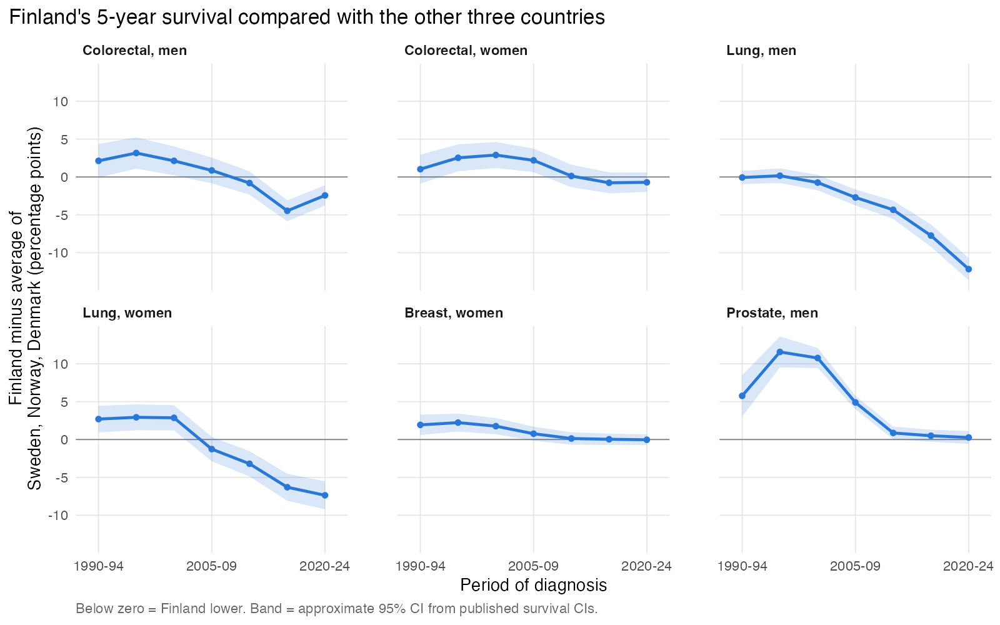

# Nordic cancer trends: is Finland falling behind?

The idea came from a [Yle MOT report](https://yle.fi/a/74-20251023) saying that cancer survival in Finland is poorer than in the other Nordic countries for several cancers. I wanted to see what the open NORDCAN data show.

A small epidemiology project in R using open registry data from NORDCAN. I compared Finland with Sweden, Norway and Denmark for colorectal, lung, breast and prostate cancer, 1990-2023. The project also has two quasi-experimental analyses: the effect of Danish colorectal cancer screening (difference-in-differences with placebo tests) and missing cancer diagnoses during COVID-19 (interrupted time series).

**Full report: [report/report.md](report/report.md)**



## Main findings

- In 1990-94 Finland's 5-year survival was at or above the Nordic average for all four cancers. In 2020-24 Finnish men with lung cancer had 5-year survival of 17.9%, against 30.1% in the other three countries. For women the gap was 7.4 percentage points.
- Colorectal cancer mortality in Finnish men has been flat since about 2009, while it fell 2.4-3.5% per year in the other countries. Finland had the lowest colorectal and breast cancer mortality in 1990 but not in 2023.
- Lung cancer incidence and mortality in Finnish men fell faster than anywhere else in the Nordics. Breast and prostate cancer survival is now about the same in all four countries.
- After Denmark started screening in 2014, colorectal cancer at ages 50-74 rose about 18% during the first screening round and was about 9% lower than expected in 2018-2021, compared with Finland and Norway. Three placebo tests showed no effect.
- In 2020 about 10% of expected prostate cancers and 6% of breast cancers were not diagnosed. Sweden had the largest drop (prostate, -19%).

The data are aggregated country-level statistics, so these are population patterns, not causal effects for individual patients. See the limitations section of the report.

## Repository structure

```
data/raw/          NORDCAN downloads (unchanged) + README.txt data log
data/processed/    tidy data made by R/01_import_clean.R
R/                 analysis scripts, run in order
  00_setup.R         packages, settings, plot style
  01_import_clean.R  read and check raw files
  02_trends.R        APCs (quasi-Poisson) and breakpoints (segmented)
  03_screening_did.R Danish screening: DiD, event study, placebo tests
  04_covid_its.R     COVID-19 observed vs expected cases
  05_survival.R      5-year survival and the Finland gap
output/            result tables (csv)
figures/           figures used in the report
report/report.md   the report
run_all.R          runs everything
```

## How to run

1. Install R (4.3 or newer) and the packages:
   ```r
   install.packages(c("dplyr", "tidyr", "readr", "purrr", "ggplot2",
                      "jsonlite", "segmented", "MASS", "scales"))
   ```
2. Open `nordic-cancer-trends.Rproj` in RStudio.
3. Run `source("run_all.R")`. It takes about 30 seconds.

The code was run with R 4.3.3, dplyr 1.1.4, ggplot2 3.4.4 and segmented 2.0.3.

## Data source

NORDCAN: Cancer Incidence, Mortality, Prevalence and Survival in the Nordic Countries, Version 9.6. Association of the Nordic Cancer Registries. https://nordcan.iarc.fr/

NORDCAN data are in the public domain but must be cited. Details of every download are in `data/raw/README.txt`.
