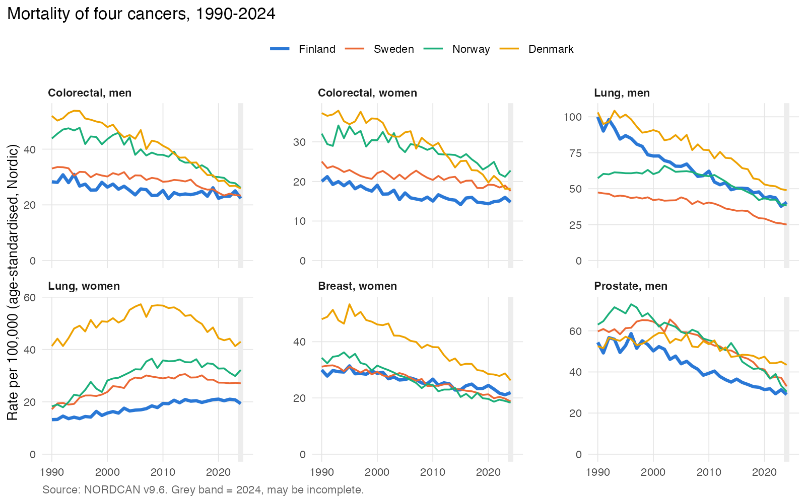
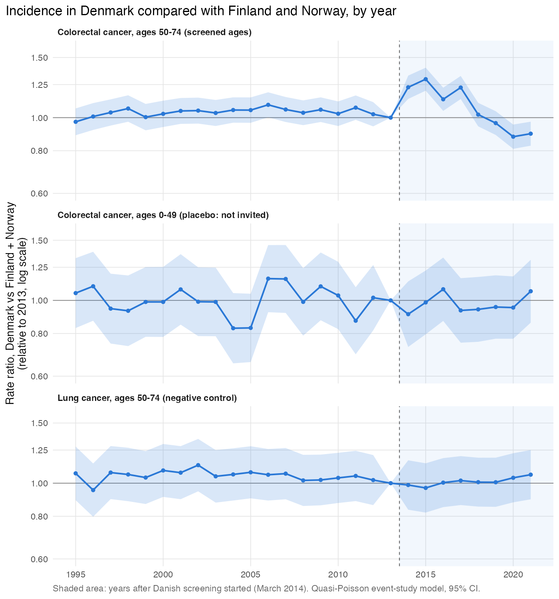
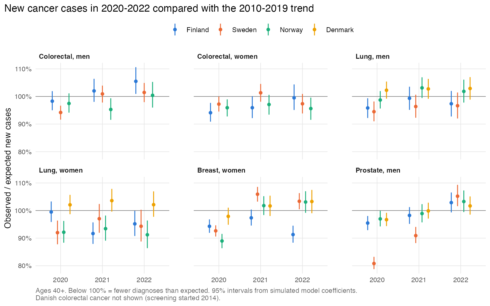

# Is Finland falling behind? Cancer trends in Finland and the other Nordic countries, 1990-2023

## 1. Background and questions

This project started from a news story. Yle's investigative programme MOT reported that Finland has no national data on cancer treatment delays, and that earlier studies have found poorer survival in Finland than in the other Nordic countries for several cancers (https://yle.fi/a/74-20251023). I wanted to see what the open registry data show, so I compared Finland with Sweden, Norway and Denmark for four common cancers: colorectal, lung, female breast and prostate cancer. The Nordic countries have similar health systems and good cancer registries, so they are easy to compare.

I had three questions:

1. How have incidence, mortality and 5-year survival changed in Finland since 1990, compared with Sweden, Norway and Denmark?
2. Did the Danish colorectal cancer screening programme, which started in 2014, change colorectal cancer rates in Denmark? Finland and Norway did not have national screening until 2022, so they can be used as a comparison.
3. How many cancer diagnoses were missing during the COVID-19 pandemic?

This is a portfolio project. I used only open, aggregated data, so the results describe countries and not individual patients.

## 2. Data

All data come from NORDCAN version 9.6. I used yearly age-standardised incidence and mortality rates, case and death counts with population for 18 age groups, and age-standardised 5-year relative survival for 5-year diagnosis periods (1990-94 to 2020-24). The main analysis covers 1990-2023. I left out 2024 because the newest registry year is often incomplete.

The data had no missing values, and the age-specific counts matched the yearly totals. Finland's age-specific counts are often not whole numbers (for example 0.6 cases), but the totals are correct.

## 3. Methods

All analysis was done in R (`R/` folder, `run_all.R` runs everything).

- Trends: quasi-Poisson regression on age-specific counts, adjusted for age, with a dummy for 2020. The year coefficient gives the annual percent change (APC). An extra slope term tested whether Finland differed from the others, and segmented regression found years where trends changed.
- Danish screening: difference-in-differences comparing colorectal cancer at ages 50-74 in Denmark with Finland and Norway, 1995-2021, with separate effects for 2014-2017 (first screening round) and 2018-2021. I checked parallel trends before 2014 and ran three placebo tests: ages 0-49, lung cancer, and a fake start year of 2008.
- COVID-19: the 2010-2019 trend was used to predict expected cases in 2020-2022 and compared with observed cases.
- Survival: Finland's 5-year survival minus the average of the other three countries in each period.

## 4. Results

### 4.1 Incidence and mortality

Mortality fell in all countries for all four cancers, except lung cancer in women. For lung cancer in men, Finland had the fastest fall of the four countries (mortality -2.7% per year).

For colorectal and breast cancer, Finland had the lowest mortality in 1990, but it has fallen more slowly since then:

| Mortality, APC 1990-2023 (%) | Finland | Sweden | Norway | Denmark |
|---|---|---|---|---|
| Colorectal, men | -0.6 | -1.0 | -1.5 | -2.1 |
| Colorectal, women | -1.0 | -0.6 | -1.0 | -1.9 |
| Breast, women | -0.9 | -1.2 | -2.0 | -1.8 |

Colorectal cancer mortality in Finnish men has been flat since about 2009. By 2023 Finland no longer had the lowest mortality for colorectal cancer in men or for breast cancer.

### 4.2 Survival

Survival improved everywhere. In 1990-94 Finland was at or above the average of the other three countries for every cancer. In 2020-24 it was behind for lung cancer and for colorectal cancer in men:

| 5-year survival, 2020-24 (%) | Finland | Others (average) | Gap (95% CI) |
|---|---|---|---|
| Lung, men | 17.9 | 30.1 | -12.2 (-13.6 to -10.7) |
| Lung, women | 30.8 | 38.2 | -7.4 (-9.2 to -5.5) |
| Colorectal, men | 69.6 | 72.0 | -2.4 (-3.8 to -1.1) |

For colorectal cancer in women, breast cancer and prostate cancer the countries are now about equal. These data cannot tell why Finnish lung cancer survival is lower; that would need stage and treatment data.

### 4.3 Colorectal cancer screening in Denmark

Before 2014, Danish colorectal incidence moved in parallel with Finland and Norway. After screening started, incidence was 18% higher than expected in 2014-2017 (rate ratio 1.18, 95% CI 1.14-1.21) and 9% lower in 2018-2021 (0.91, 0.88-0.94). This fits screening first finding existing cancers and later preventing some. The three placebo tests showed no effect, and the results were similar when Sweden was added to the comparison group. For colorectal deaths the parallel-trends check failed, so I could not estimate an effect on mortality.

### 4.4 COVID-19

In 2020 about 10% of expected prostate cancers and 6% of breast cancers were not diagnosed in the four countries. The largest drop was prostate cancer in Sweden (19% fewer than expected), which caught up by 2022.

## 5. Limitations

- The data are aggregated by country, sex, age and year. The results are about population rates, and nothing here can be applied to individual patients. Differences between countries can come from many things at once, such as smoking history, screening, diagnostics, treatment and registration practice.
- The difference-in-differences analysis has only one treated country and two comparison countries. The confidence intervals come from the count model and do not account for country-level variation, so they are probably too narrow. The placebo tests make the incidence result more believable, but they do not prove it.
- The comparison countries were not completely unscreened. Finland ran a randomised screening programme for part of the population aged 60-69 in 2004-2016, and both Finland and Norway started national screening in 2022.
- The 2018-2021 period includes the COVID-19 years. The shared year effects remove a common drop, but the pandemic may have affected screening differently in each country.
- The COVID-19 analysis assumes the 2010-2019 trend would have continued. For a few series (for example Finnish breast cancer) the trend was already changing, so the expected numbers are uncertain.
- I fitted the breakpoint models to age-standardised rates, not with the official Joinpoint software, so the results are close to joinpoint regression but not the same.
- Coding systems changed in Norway and Sweden in 1993 and in Sweden and Finland around 2005-2007. Some of the breakpoints found in the mid-1990s may be partly caused by this. I did not test it formally.
- Finland's non-integer age-specific counts are not explained in the documentation.

## 6. Conclusions

Finland is not behind in everything. Lung cancer incidence and mortality in Finnish men fell faster than in the other countries, and breast and prostate cancer survival is now the same in all four countries. But for colorectal cancer in men and for breast cancer, mortality has fallen more slowly in Finland than in the other countries, and Finland has lost the low mortality it had in 1990. The biggest gap is in lung cancer survival, where Finland was equal in the early 1990s and is now 12 percentage points behind for men and 7 points behind for women. This partly agrees with the Yle report. Finnish survival is lower for lung cancer and for colorectal cancer in men, but not for breast or prostate cancer, where Finland is now level with the other countries. These data say nothing about treatment delays, which was the main point of the report.

The Danish screening comparison shows that colorectal incidence first rose by about 18% and then fell by about 9% after screening started, and the placebo tests support this. Finland started national colorectal screening in 2022, and the Danish data suggest what Finnish incidence figures may look like over the next few years.

A useful next step would be patient-level data with stage at diagnosis, for example from the Finnish Cancer Registry, to see whether the lung cancer survival gap comes from later diagnosis.
